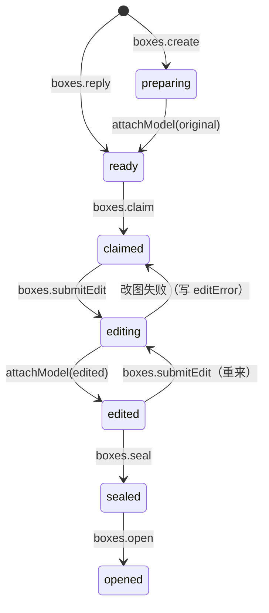

# 一起搭 · 盲盒版 后端 API

客户端用 `convex/react` 的 `ConvexReactClient` 调用，名字形如 `api.boxes.create`。query 可订阅，状态变化实时推送。

> 当前是 T0 空壳：参数校验已是最终版，返回值是固定假数据（id 形如 `fake_box`，不能再传回其它函数）。各任务合并后变成真实实现，形状不变。

## 约定

- 文件一律返回 url，前端不碰 storageId。上传流程：`files.generateUploadUrl()` → POST 文件 → 拿到 `storageId` 传给对应函数。
- 图片只接受 `image/jpeg`、`image/png`；HEIC 先转 JPEG、长边缩到 1536 以内。定格图（snapshot）必须是透明背景 PNG。开箱视频接受 `video/mp4`、`video/quicktime`。
- 没有登录，`userId` 存在手机本地，按参数传。
- 错误统一是 `ConvexError`，`error.data` 为 `{ code, message }`，见文末错误码表。

## 函数清单

| 名字 | 类型 | 参数 | 返回 |
| --- | --- | --- | --- |
| `users.register` | mutation | `nickname: string`（去空格后 1–20 字） | `{ userId, nickname, color }` |
| `files.generateUploadUrl` | mutation | 无 | `string`（上传地址） |
| `boxes.create` | mutation | `userId`, `photoStorageId`, `senderNote?: string` | `{ boxId }` |
| `boxes.get` | query | `boxId`, `viewerId?: userId` | `BoxView` |
| `boxes.inbox` | query | `userId`（不存在报 `USER_NOT_FOUND`） | `{ received: (BoxView & { action })[]; sent: BoxView[] }` |
| `boxes.claim` | mutation | `code: string`, `userId` | `{ boxId }` |
| `boxes.submitEdit` | mutation | `boxId`, `userId`, `snapshotStorageId`, `sceneShotStorageId?`, `cameraPose: CameraPose`, `prompt: string`（1–200 字）, `extraPhotoStorageId?` | `null` |
| `boxes.seal` | mutation | `boxId`, `userId`, `receiverNote: string` | `null` |
| `boxes.open` | mutation | `boxId`, `userId` | `BoxView` |
| `boxes.reply` | mutation | `boxId`（旧盒子）, `userId`, `senderNote?: string` | `{ boxId }`（新盒子） |
| `boxes.attachModel` | mutation | `boxId`, `kind: "original" \| "edited"`, `modelStorageId?` 或 `modelUrl?`（二选一）, `token?`（设了 `KARA_TOKEN` 时必须一致，否则报 `INVALID_INPUT`） | `null`（传 `modelUrl` 时是异步的：返回后后台下载再写回） |
| `exports.save` | mutation | `boxId`, `storageId`（开箱视频） | `{ exportId }` |
| `kara.pending` | query | 无 | `{ boxId, kind, imageUrl }[]`（给 Kara 轮询） |
| `seed.demo` | action | 可选素材 storageId：`photoId`, `cutoutId`, `modelId`, `snapshotId`, `sceneShotId`, `editedImageId`, `editedModelId`, `extraPhotoId` | `{ userAId, userBId, readyBox: { boxId, code }, sealedBox: { boxId, code } }` |

`boxes.attachModel`、`kara.pending` 给 Kara 用，`seed.demo` 给演示脚本用，App 不需要调。

`inbox` 的 `action`：`ready` → `"claim"`，`claimed / editing / edited` → `"edit"`，我寄出且已 `sealed` → `"open"`。一个 sealed 盒子会同时出现在 received 和 sent。

## 类型

```ts
type BoxStatus = "preparing" | "ready" | "claimed" | "editing" | "edited" | "sealed" | "opened";

type CameraPose = { position: [number, number, number]; target: [number, number, number]; fov: number };

type BoxView = {
  _id: Id<"boxes">; _creationTime: number; code: string; status: BoxStatus;
  senderId: Id<"users">; senderNickname: string;
  receiverId?: Id<"users">; receiverNickname?: string; replyTo?: Id<"boxes">;
  senderNote?: string; photoUrl: string; cutoutUrl?: string; modelUrl?: string;
  // B 的改造：viewerId 是寄件人 A 且还没开盒时，下面这些全部省略
  snapshotUrl?: string; sceneShotUrl?: string; cameraPose?: CameraPose; prompt?: string;
  extraPhotoUrl?: string; editedImageUrl?: string; editedModelUrl?: string; receiverNote?: string;
  editError?: string; sealedAt?: number; openedAt?: number;
};
```

例外：盒子还在 `preparing` 时 A 能看到 `editError`（这时它是抠图失败原因，属于 A 自己的盒子）。

TypeScript 里可以直接 `import type { BoxView, CameraPose } from "<后端>/convex/lib/view"`。

## 状态机



## 错误码

| code | 场景 |
| --- | --- |
| `USER_NOT_FOUND` | userId 不存在 |
| `BOX_NOT_FOUND` | boxId 或盒子码不存在 |
| `NOT_READY` | 认领时盒子还没 ready |
| `ALREADY_CLAIMED` | 盒子已被别人认领（同一个人重复认领不报错） |
| `NOT_RECEIVER` | 非 B 调用 B 才能调的函数 |
| `NOT_SENDER` | 非 A 调用 A 才能调的函数 |
| `WRONG_STATUS` | 当前状态不允许这个操作 |
| `INVALID_INPUT` | 参数格式不对（prompt 为空、cameraPose 缺字段、文件类型不对、认领自己的盒子） |

参数类型不对（比如 `kind: "bogus"`）会在校验层被拒，抛的是 Convex 的 `ArgumentValidationError`，不带 code。
