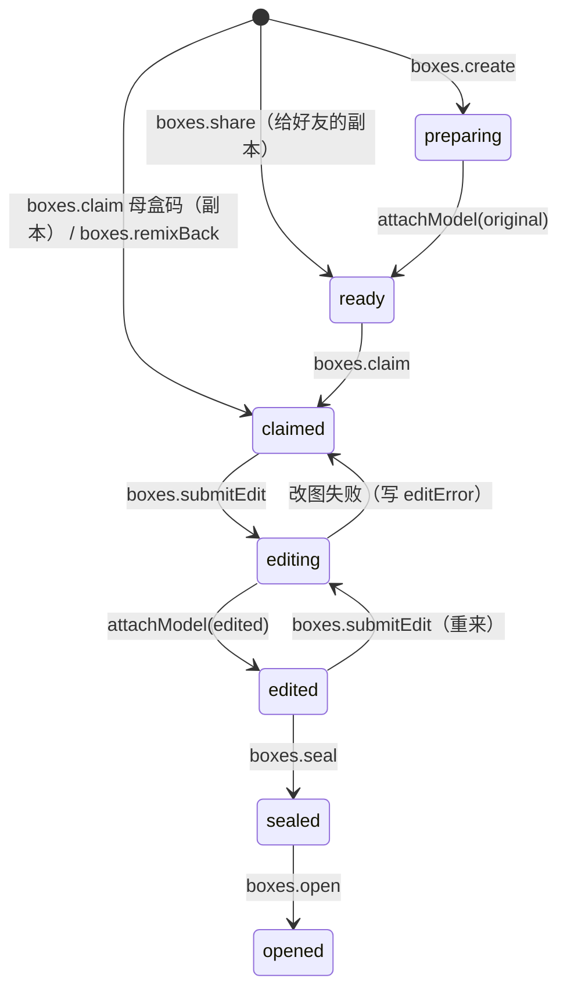

# 一起搭 · 盲盒版 后端 API

客户端用 `convex/react` 的 `ConvexReactClient` 调用，名字形如 `api.boxes.create`。query 可订阅，状态变化实时推送。

> 当前是 T0 空壳：参数校验已是最终版，返回值是固定假数据（id 形如 `fake_box`，不能再传回其它函数）。各任务合并后变成真实实现，形状不变。

## 约定

- 文件一律返回 url，前端不碰 storageId。上传流程：`files.generateUploadUrl()` → POST 文件 → 拿到 `storageId` 传给对应函数。
- 图片只接受 `image/jpeg`、`image/png`；HEIC 先转 JPEG、长边缩到 1536 以内。定格图（snapshot）必须是透明背景 PNG。开箱视频接受 `video/mp4`、`video/quicktime`。
- 没有登录，`userId` 存在手机本地，按参数传。
- 错误统一是 `ConvexError`，`error.data` 为 `{ code, message }`，见文末错误码表。

## 函数清单

| 名字 | 类型 | 参数 | 返回 |
| --- | --- | --- | --- |
| `users.register` | mutation | `nickname: string`（去空格后 1–20 字） | `{ userId, nickname, color }` |
| `users.friends` | query | `userId`（不存在报 `USER_NOT_FOUND`） | `{ userId, nickname, color }[]`：和我互相寄过盒子的人，去重，最近往来在前 |
| `files.generateUploadUrl` | mutation | 无 | `string`（上传地址） |
| `boxes.create` | mutation | `userId`, `photoStorageId`, `senderNote?: string` | `{ boxId }` |
| `boxes.get` | query | `boxId`, `viewerId?: userId` | `BoxView` |
| `boxes.inbox` | query | `userId`（不存在报 `USER_NOT_FOUND`） | `{ received: (BoxView & { action })[]; sent: BoxView[] }` |
| `boxes.claim` | mutation | `code: string`, `userId` | `{ boxId }`（认领分享母盒的码时，返回的是给你新建的副本，不是母盒） |
| `boxes.submitEdit` | mutation | `boxId`, `userId`, `snapshotStorageId`, `sceneShotStorageId?`, `cameraPose: CameraPose`, `prompt: string`（1–200 字）, `extraPhotoStorageId?` | `null` |
| `boxes.seal` | mutation | `boxId`, `userId`, `receiverNote: string` | `null` |
| `boxes.open` | mutation | `boxId`, `userId` | `BoxView` |
| `boxes.share` | mutation | `boxId`（A 自己的 ready 原盒子）, `userId`, `receiverIds: Id<"users">[]`（可为空）, `senderNote?: string` | `{ boxIds: Id<"boxes">[] }`，和去重后的 `receiverIds` 一一对应 |
| `boxes.remixBack` | mutation | `boxId`（A 寄出、已 opened 的旧盒子）, `userId`（A） | `{ boxId }`（接力盒子） |
| `boxes.attachModel` | mutation | `boxId`, `kind: "original" \| "edited"`, `modelStorageId?` 或 `modelUrl?`（二选一）, `token?`（设了 `KARA_TOKEN` 时必须一致，否则报 `INVALID_INPUT`） | `null`（传 `modelUrl` 时是异步的：返回后后台下载再写回） |
| `exports.save` | mutation | `boxId`, `storageId`（开箱视频） | `{ exportId }` |
| `kara.pending` | query | 无 | `{ boxId, kind, imageUrl }[]`（给 Kara 轮询） |
| `seed.demo` | action | 可选素材 storageId：`photoId`, `cutoutId`, `modelId`, `snapshotId`, `sceneShotId`, `editedImageId`, `editedModelId`, `extraPhotoId` | `{ userAId, userBId, readyBox: { boxId, code }, sealedBox: { boxId, code } }` |

`boxes.attachModel`、`kara.pending` 给 Kara 用，`seed.demo` 给演示脚本用，App 不需要调。

### 多选分享：`boxes.share`

- 对每个好友建一个副本盒子：复用原盒子的照片、抠图、模型（不复制文件），`receiverId` 预填为好友，状态 `ready`，各自新的 6 位码，`sharedFrom` 指向原盒子，`senderNote` 写入（不传就沿用原盒子的留言）。好友在 inbox 里看到 `action: "claim"`，用副本的码（或原盒子的码）`boxes.claim` 后变 `claimed`。
- 原盒子变成"分享母盒"：`shared: true`，永远停在 `ready`、没有 receiver，传了 `senderNote` 会更新它。Invite 分享的是原盒子的码：任何人用它 `boxes.claim` 都会得到一个属于自己的 `claimed` 副本，不会抢走别人的；同一个人重复认领返回同一个副本；已经被 share 选中的好友用原盒子码认领，拿到的就是给他的那个副本。
- 可以多次调用（比如先只走 Invite，后来再加好友）；已经给过的好友返回已有副本，不重复建。
- 母盒会出现在 A 的 `inbox.sent` 里（`ready`、无 receiver、`shared: true`），UI 可以按 `shared` 过滤或显示成"邀请"。
- 错误：不是 sender → `NOT_SENDER`；原盒子还在 `preparing` → `NOT_READY`；其它状态、已有 receiver 的盒子、副本本身 → `WRONG_STATUS`；`receiverIds` 里有不存在的用户 → `USER_NOT_FOUND`；包含自己 → `INVALID_INPUT`。报错时什么都不写。
- 没调过 `share` 的盒子，`claim` 行为不变：第一个认领的人拿走盒子本身。

### 来回接力：`boxes.remixBack`

A 打开 B 改好的盒子后，在 B 的结果上再改一次寄回给 B。新盒子：照片和抠图用旧盒子的 `editedImage`，模型用 `editedModel`，`senderId` = B，`receiverId` = A，状态直接是 `claimed`，`replyTo` 指向旧盒子。于是 A 走改造流程（`submitEdit` → `edited` → `seal`），封箱后 B 的 inbox 出现 `action: "open"`，B 开盒后可以对这个盒子再 `remixBack`，一直来回。同一个旧盒子重复调用返回同一个新盒子。错误：不是旧盒子的 sender → `NOT_SENDER`；旧盒子不是 `opened`（或缺少改造结果）→ `WRONG_STATUS`。

原来的 `boxes.reply` 已删除，由 `remixBack` 取代。

`inbox` 的 `action`：`ready` → `"claim"`，`claimed / editing / edited` → `"edit"`，我寄出且已 `sealed` → `"open"`。一个 sealed 盒子会同时出现在 received 和 sent。接力盒子对 A（receiver）是 `"edit"`，对 B（sender）在 sealed 之前只出现在 sent，sealed 后出现在 received 里且是 `"open"`。

## 类型

```ts
type BoxStatus = "preparing" | "ready" | "claimed" | "editing" | "edited" | "sealed" | "opened";

type CameraPose = { position: [number, number, number]; target: [number, number, number]; fov: number };

type BoxView = {
  _id: Id<"boxes">; _creationTime: number; code: string; status: BoxStatus;
  senderId: Id<"users">; senderNickname: string; senderColor: string;
  receiverId?: Id<"users">; receiverNickname?: string; receiverColor?: string;
  replyTo?: Id<"boxes">;      // 接力盒子指向上一棒
  shared?: true;              // 分享母盒（调过 boxes.share 的原盒子）
  sharedFrom?: Id<"boxes">;   // 分享副本指向母盒
  senderNote?: string; photoUrl: string; cutoutUrl?: string; modelUrl?: string;
  // B 的改造：viewerId 是寄件人 A 且还没开盒时，下面这些全部省略
  snapshotUrl?: string; sceneShotUrl?: string; cameraPose?: CameraPose; prompt?: string;
  extraPhotoUrl?: string; editedImageUrl?: string; editedModelUrl?: string; receiverNote?: string;
  editError?: string; sealedAt?: number; openedAt?: number;
};
```

例外：盒子还在 `preparing` 时 A 能看到 `editError`（这时它是抠图失败原因，属于 A 自己的盒子）。

TypeScript 里可以直接 `import type { BoxView, CameraPose } from "<后端>/convex/lib/view"`。

## 状态机



## 错误码

| code | 场景 |
| --- | --- |
| `USER_NOT_FOUND` | userId 不存在 |
| `BOX_NOT_FOUND` | boxId 或盒子码不存在 |
| `NOT_READY` | 认领或分享时盒子还没 ready |
| `ALREADY_CLAIMED` | 盒子已被别人认领（同一个人重复认领不报错） |
| `NOT_RECEIVER` | 非 B 调用 B 才能调的函数 |
| `NOT_SENDER` | 非 A 调用 A 才能调的函数 |
| `WRONG_STATUS` | 当前状态不允许这个操作 |
| `INVALID_INPUT` | 参数格式不对（prompt 为空、cameraPose 缺字段、文件类型不对、认领自己的盒子、分享给自己） |

参数类型不对（比如 `kind: "bogus"`）会在校验层被拒，抛的是 Convex 的 `ArgumentValidationError`，不带 code。

## 后端环境变量

| 名字 | 用途 |
| --- | --- |
| `OPENAI_API_KEY` | OpenAI 图像编辑，抠图（`prepare.run`）和一句话改图（`edit.run`）都用它 |
| `OPENAI_IMAGE_MODEL` | 图像编辑模型，默认 `gpt-image-2.6-flare`，抠图和改图共用 |
| `MOCK_AI` | 设为 `1` 时不调任何外部 AI 服务 |
| `MOCK_3D` | 设为 `1` 时只假 3D（`kara.request` 走 `kara.fake`），抠图和改图仍走真实服务 |
| `KARA_WEBHOOK_URL`、`KARA_TOKEN` | 可选：通知 Kara 的地址、`attachModel` 的校验口令 |
| `EDIT_FAL_CUTOUT` | 设为 `1` 时，一句话改图的结果会再用 `lib/cutout.ts` 的 `removeBackground`（OpenAI）去一次背景；默认不设，直接存 OpenAI 返回的透明 PNG。名字是历史遗留，已经不走 fal |

抠图不再用 fal，没有 `FAL_KEY` / `FAL_BG_MODEL`。
